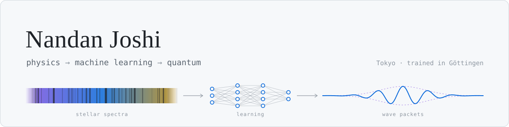

<picture>
  <source media="(prefers-color-scheme: dark)" srcset="assets/banner-dark.svg">
  
</picture>

Physicist by training, now working where machine intelligence, quantum computing and cryptography for digital assets meet. What ties them together for me is how information becomes structure, signal, and eventually knowledge.

## Now

<table>
<tr>
<td width="50%" valign="top">

**[QMI Lab](https://qmilab.com)** · the independent lab I run 
Research on intelligence and learning across classical and quantum computation. Current work: hybrid quantum-classical Transformer fine-tuning, and cross-lingual transfer through romanization.

</td>
<td width="50%" valign="top">

**[AstroLLM](https://astrollm.org)** · building an LLM for astronomy 
Retrieval-grounded, QLoRA-tuned on Qwen3, wired to NASA ADS, SIMBAD and the Exoplanet Archive. Evaluated on grounding, tool routing, abstention and teaching quality.

</td>
</tr>
<tr>
<td width="50%" valign="top">

**Agent infrastructure** · open source from QMI Lab 
[Lodestar](https://github.com/qmilab/lodestar), a trust layer for AI agents: what an agent believed, why it acted, and whether it was right. [Asterism](https://github.com/qmilab/asterism), a local-first runtime for many distinct agents, each with its own memory, secrets, skills and autonomy.

</td>
<td width="50%" valign="top">

**Confidential Digital Assets** · privacy on public ledgers 
What confidential-token systems actually hide, established by running them rather than reading their docs, with every claim traced to evidence. Two studies so far: [XLS-96 on the XRP Ledger](https://github.com/nandanito/xrpl-confidential-positions) ([write-up](https://nandan.me/writing/amounts-not-relationships/)) and [Zeto on Paladin (EVM)](https://github.com/nandanito/evm-confidential-positions).

</td>
</tr>
<tr>
<td width="50%" valign="top">

**PQC** · post-quantum cryptography 
Implementing post-quantum schemes from their NIST standards, and explaining them along the way. First project: [slh-dsa-zig](https://github.com/nandanito/slh-dsa-zig), SLH-DSA (FIPS 205) in pure Zig, with a [guide](https://nandan.me/slh-dsa-zig/) to how the scheme works.

</td>
<td width="50%" valign="top">

**[CrossMono](https://github.com/nandanito/crossmono)** · open e-reader firmware 
Reading-first firmware for the M5Stack PaperMono e-paper devices (ESP32-S3), built on CrossPoint Reader and the FreeInk SDK, with changes contributed upstream to both. Installs from the browser at [crossmono.github.io](https://crossmono.github.io).

</td>
</tr>
</table>

Beyond the lab, I work across the wider quantum computing stack: algorithms and circuits, hybrid quantum-classical methods, simulators and hardware back-ends, and the developer tooling that connects them.

Also learning in public: [array-thinking-to-q](https://github.com/nandanito/array-thinking-to-q), from J to q/kdb+ with every example executed.

## Writing

<!-- BLOG-POST-LIST:START -->
- [Amounts, not relationships: what confidential transfers on the XRP Ledger hide](https://nandan.me/writing/amounts-not-relationships/)
- [Unlearn the loop: what J shows that q hides](https://nandan.me/writing/unlearn-the-loop/)
- [The as-of join: what changes when the engine is built around one primitive](https://nandan.me/writing/the-as-of-join/)
- [No headroom: what a null result on KX’s q plugin actually measured](https://nandan.me/writing/no-headroom-kx-q-plugin/)
- [Array thinking, all the way to q](https://nandan.me/writing/array-thinking-all-the-way-to-q/)
<!-- BLOG-POST-LIST:END -->

More at [nandan.me/writing](https://nandan.me/writing/).

## Background

- **Diplom Physik, Göttingen (2007).** DFG-funded doctoral research in stellar astrophysics at the Institut für Astrophysik Göttingen: observing at ESO facilities in Chile, custom IDL pipelines for spectroscopic analysis.
- **Max Planck Institute for Dynamics and Self-Organization.** Q-learning agents controlling simulated artificial muscles, with the biomechanics modeled through Lagrangian mechanics. Reinforcement learning from before the deep-RL era.
- **Publication:** Reiners et al., *A Catalog of Rotation and Activity in Early-M Stars.* The Astronomical Journal 143, 93 (2012). [ADS](https://ui.adsabs.harvard.edu/abs/2012AJ....143...93R/abstract)

## Toolbox

            

## Elsewhere

[nandan.me](https://nandan.me) · [qmilab.com](https://qmilab.com) · [astrollm.org](https://astrollm.org) · [LinkedIn](https://linkedin.com/in/NandanJoshi) · [X](https://x.com/nandanito)
